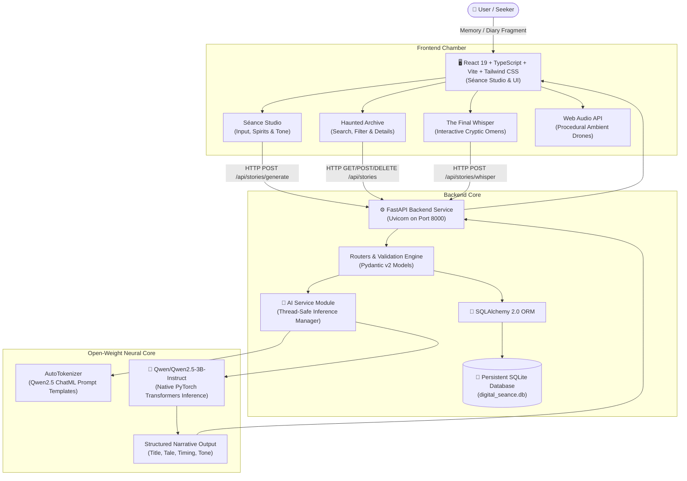

# 🕯️ DIGITAL SÉANCE

> *"The past has a story. Let the machine tell it."*

[](https://hacktoberfest.com/)
[](https://dev.to)
[](https://huggingface.co/Qwen/Qwen2.5-3B-Instruct)
[](LICENSE)
[](https://python.org)
[](https://fastapi.tiangolo.com)
[](https://react.dev)

A full-stack open-source AI storytelling application crafted from scratch for **Hacktoberfest 2026 Open-Source AI Challenge — Week 4: Ghost in the Machine**.

Digital Séance transforms user-provided memories, diary fragments, family legends, and historical coincidences into atmospheric, spine-chilling supernatural chronicles using the **Qwen/Qwen2.5-3B-Instruct** open-weight model via local Hugging Face Transformers inference.

---

## 🔮 Interface Showcase

```
+---------------------------------------------------------------------------------------+
|  [🕯️ DIGITAL SÉANCE]   [Studio]   [Archive]   [Machine Specs]   [About]  [✨ Final Whisper] |
+---------------------------------------------------------------------------------------+
|                                                                                       |
|                                    DIGITAL SÉANCE                                     |
|                     "The past has a story. Let the machine tell it."                  |
|                                                                                       |
|   +---------------------------------------+   +-----------------------------------+   |
|   | 📜 MEMORY ALTAR                       |   | 📖 THE MANIFESTATION SCROLL       |   |
|   | "I found an old photograph in my      |   |                                   |   |
|   | grandfather's room. There was a       |   | TITLE: The Face in the Silver Nit |   |
|   | person standing behind him..."        |   |                                   |   |
|   |                                       |   | The room smelled of dust and dry  |   |
|   | SPIRIT: [The Forgotten One]           |   | lavender. The silver nitrate was  |   |
|   | TONE:   [Psychological Horror]        |   | peeling from the edges of the     |   |
|   | LENGTH: [Medium]                      |   | tintype, but the eyes behind your |   |
|   |                                       |   | grandfather were clear...         |   |
|   | [ 🕯️ SUMMON THE STORY ]               |   |                                   |   |
|   +---------------------------------------+   +-----------------------------------+   |
+---------------------------------------------------------------------------------------+
```

---

## ⚔️ Architectural Blueprint



---

## 🌟 Key Features

1. **The Summoning (Séance Studio):**
   - Transmutes raw text into gothic, psychological, and supernatural narratives.
   - Character counter, input validation, and atmospheric preloaded prompt seeds.
   - Selection of 5 unique Spirit Personas with distinct voices.
   - 5 nuanced atmospheric tones: *Psychological horror*, *Gothic mystery*, *Supernatural suspense*, *Melancholic remembrance*, and *Cosmic horror*.
   - Multilingual support: English and Hindi (हिंदी).
   - Creative variance (temperature) slider.

2. **The 5 Guiding Spirit Personas:**
   - **The Forgotten One:** Mysterious, melancholic; mourns lost names, rust, and silence.
   - **The Shadow:** Dark, visceral, suffocating tension and terrifying dread.
   - **The Lost Traveler:** Eerie mystery across phantom trains, fogbound tracks, and thresholds.
   - **The Memory Keeper:** Poetic, nostalgic; honors sepia photographs and unfinished grief.
   - **The Digital Phantom:** Retro computer techno-horror echoing from corrupted tapes and CRT monitors.

3. **The Haunted Archive (Persistent Storage):**
   - Stores all generated stories in SQLite (`digital_seance.db`).
   - Real-time search across titles, memory seeds, and story text.
   - Multi-attribute filtering (by Spirit and Tone) and chronological sorting.
   - Individual chronicle reading rooms with adjustable reading typography.
   - Story export to `.txt` and one-click clipboard copying.

4. **The Path Not Taken (Alternate Endings):**
   - Directly branches off an existing story's mid-point tension.
   - Uses the open-weight model to generate an unexpected, subverted conclusion while preserving narrative continuity.

5. **The Final Whisper (Cryptic Transmissions):**
   - Standalone occult feature channeling short, poetic, spine-chilling omens.
   - Categories: *Forgotten memory*, *Midnight warning*, *Lost soul*, *Digital ghost*, and *Strange coincidence*.

6. **Supernatural Audio Ambiance:**
   - Integrated Web Audio API procedural sound engine generating harmonic minor drone chords with zero external dependencies.

---

## 🛡️ Why Open-Weight AI Matters

Unlike closed AI wrappers that require paid API subscriptions (OpenAI, Gemini, Claude) and funnel sensitive user diary entries into commercial surveillance pipelines:

- **100% Open-Weight:** Powered by **Qwen/Qwen2.5-3B-Instruct**, released under the open **Apache 2.0 License**.
- **Local Transformers Inference:** Weights run directly through Hugging Face `transformers` and `torch`.
- **Zero Data Harvesting:** User memories never leave your machine or private server.
- **Truthful System Status:** Never simulates AI responses or returns fake hardcoded outputs. If hardware resources are constrained, the application reports its status transparently.

---

## 🛠️ Technology Stack

| Layer | Technologies |
|---|---|
| **Frontend** | React 19, TypeScript, Vite, Tailwind CSS v4, Framer Motion, Lucide React |
| **Backend** | Python 3.11+, FastAPI, Uvicorn, Pydantic v2, SQLAlchemy 2.0 |
| **AI Inference** | PyTorch, Hugging Face Transformers, Accelerate, Hugging Face Hub |
| **Default Model** | `Qwen/Qwen2.5-3B-Instruct` (Apache 2.0) |
| **Database** | SQLite with persistent disk support |
| **Deployment** | Render Blueprint (`render.yaml`) & Docker-ready architecture |

---

## 🚀 Quickstart & Local Setup

### 1. Prerequisites
- Python 3.11 or 3.12
- Node.js v18+ and npm
- 8GB+ System RAM (or modern NVIDIA GPU with 4GB+ VRAM)

### 2. Clone Repository
```bash
git clone https://github.com/your-username/digital-seance.git
cd digital-seance
```

### 3. Backend Setup
```bash
cd backend

# Create virtual environment (optional but recommended)
python -m venv venv
# Windows:
.\venv\Scripts\activate
# Linux/macOS:
source venv/bin/activate

# Install dependencies
pip install -r requirements.txt

# Copy environment file
cp .env.example .env

# Run FastAPI backend
uvicorn app.main:app --reload --port 8000
```
Backend will be live at `http://localhost:8000` with Swagger documentation at `http://localhost:8000/docs`.

### 4. Frontend Setup
In a new terminal window:
```bash
cd frontend

# Install dependencies
npm install

# Copy environment file
cp .env.example .env

# Start Vite development server
npm run dev
```
Frontend will be accessible at `http://localhost:5173`.

---

## ⚙️ Environment Variables

### Backend (`backend/.env`)
| Variable | Default | Description |
|---|---|---|
| `MODEL_ID` | `Qwen/Qwen2.5-3B-Instruct` | Hugging Face model repository ID |
| `MODEL_DEVICE` | `auto` | `auto`, `cuda`, or `cpu` |
| `MODEL_DTYPE` | `auto` | `auto`, `float32`, `float16`, or `bfloat16` |
| `MAX_NEW_TOKENS` | `700` | Maximum new tokens generated per invocation |
| `REPETITION_PENALTY`| `1.1` | Frequency penalty to prevent repetitive loops |
| `TEMPERATURE` | `0.7` | Sampling temperature for creative variance |
| `MODEL_LOAD_ON_STARTUP` | `false` | Preload model weights on server boot |
| `DATABASE_URL` | `sqlite:///./digital_seance.db` | SQLAlchemy connection string |
| `FRONTEND_URL` | `http://localhost:5173` | CORS allowed origin |
| `PORT` | `8000` | Port for Uvicorn |

### Frontend (`frontend/.env`)
| Variable | Default | Description |
|---|---|---|
| `VITE_API_BASE_URL` | `http://localhost:8000` | Backend API URL (leave empty for Vite proxy) |

---

## 🧪 Testing Suite

Run the full backend test suite:
```bash
cd backend
python -m pytest tests/test_api.py -v
```
Tests cover:
- `/api/health` system checks
- `/api/model/status` reporting
- Input validation boundaries (e.g. prompt length rules)
- Truthful 503 handling when model weights are unavailable
- Haunted Archive CRUD lifecycle (create, read, search, filter, delete)
- Alternate ending and Final Whisper routes

Run frontend build & TypeScript checks:
```bash
cd frontend
npm run build
```

---

## ☁️ Deployment on Render

This project includes a production-ready `render.yaml` specification for deploying frontend and backend as separate services:

1. Push your repository to GitHub.
2. In the Render Dashboard, click **New** > **Blueprint**.
3. Select your `digital-seance` repository. Render will automatically parse `render.yaml`.
4. Render provisions:
   - **`digital-seance-backend`**: FastAPI web service with a 10 GB persistent disk for the SQLite database.
   - **`digital-seance-frontend`**: High-performance static web service hosting the Vite React bundle.

### ⚠️ Cloud Resource Note
> [!IMPORTANT]
> **Qwen2.5-3B-Instruct** requires approximately 3.5 GB of RAM in half-precision or ~6.5 GB in float32.
> Render's **Free Instance (512 MB RAM)** is not sufficient to load 3B weights.
> 
> Digital Séance displays an **honest "Model Unavailable"** status instead of generating fake text.
> 
> **Options for Cloud Inference:**
> 1. Select a **Starter or Standard Instance (2GB - 4GB RAM)** on Render.
> 2. Or configure `MODEL_ID=Qwen/Qwen2.5-0.5B-Instruct` in `render.yaml` for a lightweight open-weight footprint.
> 3. Or run the backend locally on your laptop/desktop with native GPU/CPU acceleration.

---

## 🗺️ Roadmap & Future Enhancements

- [x] Full local inference with Qwen2.5-3B-Instruct.
- [x] Persistent SQLite archive with search, filter, and delete.
- [x] Alternate endings generator preserving story context.
- [x] The Final Whisper cryptic transmissions.
- [x] Web Audio API gothic drone sound engine.
- [ ] Local 4-bit / 8-bit quantization (`bitsandbytes` or `llama.cpp` GGUF engine).
- [ ] Export tales as vintage parchment PDF documents.
- [ ] Audio narration via open-weight text-to-speech (Bark / Piper TTS).

---

## 📜 License & Acknowledgements

- **Application Code:** Licensed under the [Apache License 2.0](LICENSE).
- **AI Model:** [Qwen/Qwen2.5-3B-Instruct](https://huggingface.co/Qwen/Qwen2.5-3B-Instruct) developed by the Qwen Team, Alibaba Cloud, under the Apache 2.0 License.
- **Hacktoberfest:** Created for Hacktoberfest 2026 Week 4: *Ghost in the Machine*.

